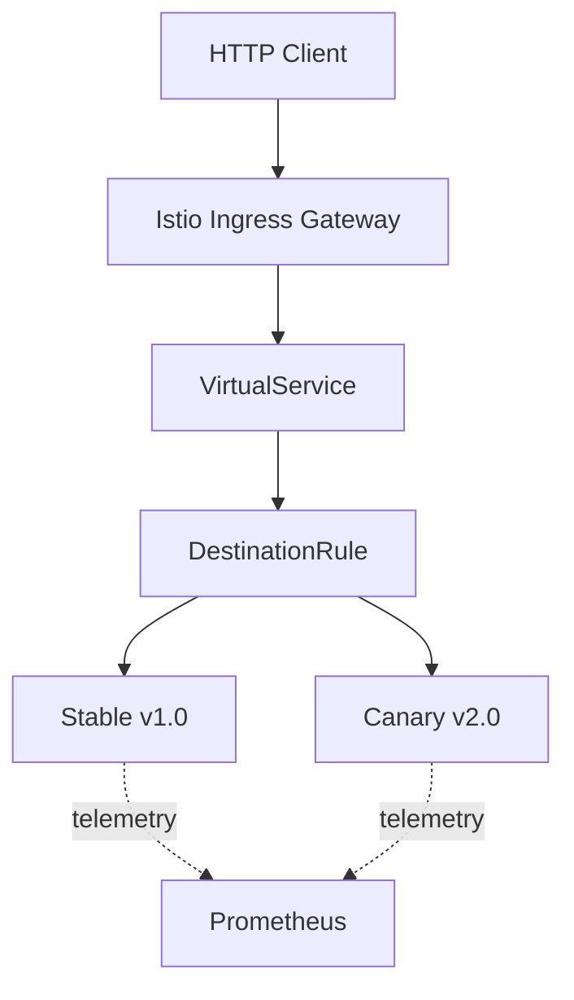
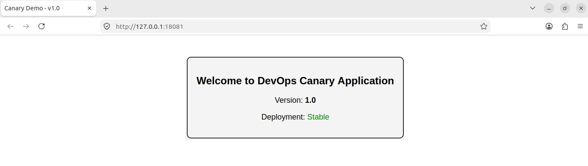
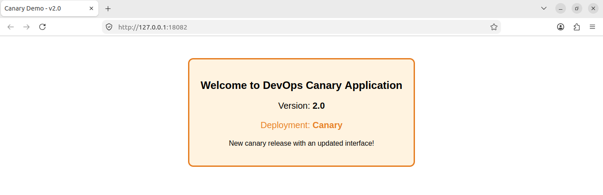
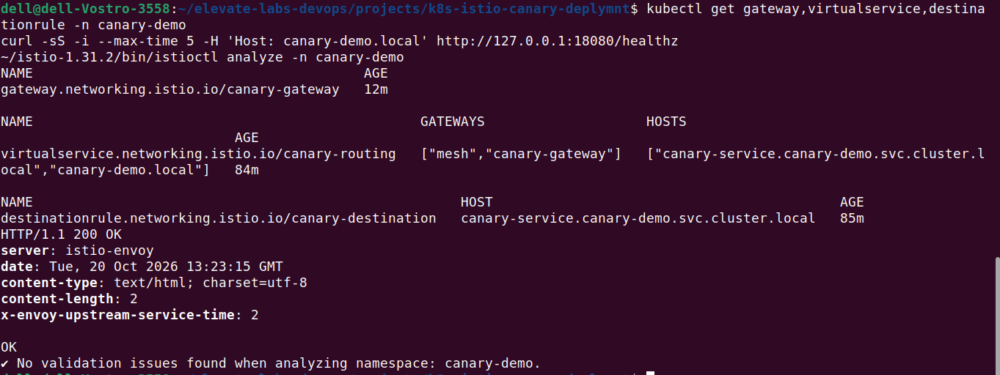
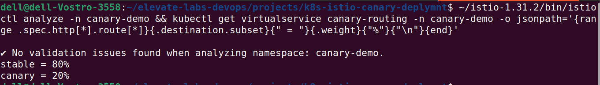

# Kubernetes Canary Deployment with Istio

A DevOps project demonstrating **canary releases, weighted traffic routing, and rollback** using Kubernetes, Minikube, and Istio.

## Objectives

- Deploy stable v1.0 and canary v2.0 versions of a Flask application.
- Control traffic distribution using Istio.
- Test multiple traffic-splitting strategies.
- Verify application health and roll back traffic safely.

## Architecture


The application runs locally in Minikube. Istio routes requests between
the two versions, while Prometheus collects Istio telemetry.

## Technology Stack and Tools

| Category           | Technologies                  |
| | - |
| Application        | Python, Flask                 |
| Containers         | Docker                        |
| Orchestration      | Kubernetes, Minikube, kubectl |
| Traffic management | Istio, Envoy                  |
| Monitoring         | Prometheus, Grafana           |
| Scripting          | Bash, Python                  |

## Key Features

- Separate Kubernetes Deployments for stable and canary versions.
- Istio Gateway, VirtualService, and DestinationRule configuration.
- 80/20, 50/50, 100%-canary, and 100%-stable routing scenarios.
- Automated HTTP traffic testing and response counts.
- Health probes and configuration validation.
- Rollback to stable v1.0 without removing the canary Deployment.

## Verified Results

Six ingress traffic scenarios were tested with 100 requests each on
21 October 2026.

| Scenario       | Stable | Canary | Errors |
| -------------- | -----: | -----: | -----: |
| 80/20 baseline |     76 |     24 |      0 |
| Stable only    |    100 |      0 |      0 |
| 80/20 retest   |     81 |     19 |      0 |
| 50/50          |     49 |     51 |      0 |
| Canary only    |      0 |    100 |      0 |
| Final rollback |    100 |      0 |      0 |

All six tests completed without unknown responses or request errors.
Finite samples may differ from configured weights.

**Final routing state:** 100% stable v1.0 and 0% canary v2.0.
Prometheus telemetry collection was verified. Grafana is installed, but
dashboard visualization was not validated.

## Screenshots

**Stable application — v1.0**



**Canary application — v2.0**







## How to Run

### Prerequisites

- Install Docker, Minikube, `kubectl`, and `istioctl`.
- Start Minikube and install Istio 1.31.2.

**Prerequisite:** Ensure the `istio-ingressgateway` Service exists in the `istio-system` namespace. This repository does not install Istio or configure the ingress Gateway.

### 1. Build and load the images

Run from the repository root:

```bash
docker build -t canary-demo:v1.0 ./app/stable
docker build -t canary-demo:v2.0 ./app/canary

minikube image load canary-demo:v1.0
minikube image load canary-demo:v2.0
```

### 2. Configure the namespace

```bash
kubectl create namespace canary-demo \
  --dry-run=client -o yaml | kubectl apply -f -

kubectl label namespace canary-demo istio-injection=enabled --overwrite
```

### 3. Deploy the application and Istio resources

```bash
kubectl apply -f k8s/stable-deployment.yaml
kubectl apply -f k8s/canary-deployment.yaml
kubectl apply -f k8s/stable-service.yaml
kubectl apply -f k8s/istio/canary-service.yaml
kubectl apply -f k8s/istio/destination-rule.yaml
kubectl apply -f k8s/istio/gateway.yaml
kubectl apply -f k8s/istio/virtual-service.yaml

kubectl rollout status deployment/stable-app -n canary-demo
kubectl rollout status deployment/canary-app -n canary-demo
istioctl analyze -n canary-demo
```

### 4. Test traffic

In a separate terminal, start the ingress port-forward:

```bash
kubectl port-forward -n istio-system \
  svc/istio-ingressgateway 18080:80
```

Check application health:

```bash
curl -i -H 'Host: canary-demo.local' \
  http://127.0.0.1:18080/healthz
```

Run 100 distribution-test requests:

```bash
./scripts/test-distribution.sh 100
```

### Rollback

Route all traffic to stable v1.0:

```bash
kubectl apply -f k8s/istio/virtual-service-rollback.yaml
```

Restore the 80/20 demonstration configuration when needed:

```bash
kubectl apply -f k8s/istio/virtual-service.yaml
```

## Repository Structure

- `app/` — stable and canary Flask applications.
- `k8s/` — Kubernetes Deployments, Services, and Istio manifests.
- `scripts/` — traffic generation and distribution tests.
- `screenshots/` — application and validation screenshots.
- `reports/` — local traffic-test reports.

## Scope

This project demonstrates progressive delivery in a local Kubernetes
environment. Cloud deployment and production-grade high availability
are outside its current scope.